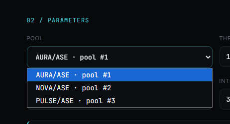

# Strata

**Trading strategies as contracts.** Write trading logic as a JavaScript contract, deploy it once, and let the
chain schedule it. The source is public, every fill is a transaction, and there is no bot process to keep alive.

Strata is a community build on chain 1423 (testnet). Source: https://github.com/Juniorj87/strata

---

## How it works

Asentum is a JavaScript-native L1 with protocol-level scheduled execution. A strategy contract arms itself
once with `cron.schedule(...)`, and the block builder fires it on time - forever. No keeper, no server.

```
        ┌────────────┐   deploy source   ┌────────────┐
        │  you (cli) │ ───────────────► │  contract  │  source + BLAKE3 hash
        └────────────┘                  └─────┬──────┘
                                              │ init(pool, token, threshold, interval)
                                              ▼
                                       ┌────────────┐
                                       │ cron job   │  interval, gas escrow
                                       └─────┬──────┘
                                             │ every interval
                                             ▼
   ┌──────────┐   consult(pool)   ┌────────────┐   Signal/Fill   ┌──────────┐
   │  Auras   │ ◄─────────────── │   tick()   │ ──────────────► │ explorer │
   │   AMM    │  TWAP + reserves │  decision  │                 │  events  │
   └──────────┘                  └─────┬──────┘                 └──────────┘
                                       │ if condition holds
                                       ▼
                                 swapExactIn(token → ASE)   via E()
```

Two constraints worth knowing before deploying one:

| | |
|---|---|
| Where the logic lives | On chain, source published in the explorer |
| Scheduler | Protocol cron registry, funded by a gas escrow |
| Which side it can trade | The **token side only**. `E()` carries no value, so strategies sell the ARC-20 leg into ASE |
| Deployment | Plain JS source, no compiler. Verified locally by BLAKE3: `blake3(source)` must equal the on-chain `codeHash` |

## Templates

Five templates live in [`contracts/`](./contracts):

- `auras-momentum-signal.js` - signal only, cheap to run, needs nothing but the cron escrow
- `auras-momentum-trader.js` - trades the token side, must be funded with ARC-20 tokens
- `twap.js`, `grid.js`, `dca.js` - execution styles on the same Auras interface

## Site

- `/` - live pool states and the real swap tape, read straight from the chain
- `/strategies` and `/strategies/:id` - on-chain registry: verified source (BLAKE3), cron job state, execution log
- `/deploy` - pick a template, set parameters, get the exact `npm run deploy:...` command
- `/how` - the model in detail, plus an interactive VM walkthrough

Wallet connect (Chrome extension or Telegram bot wallet) is wired through `@asentum/connect` -
the browser never holds a key, the wallet only signs.

## Screenshots




## Run it

```bash
npm install
npm run dev            # http://127.0.0.1:5173
npm run build          # production build
npm run chain:check    # sanity-check every RPC surface the app uses
npm run chain:verify   # BLAKE3 verification against the live Auras contract
```

## Deploying a strategy

The deployer script runs locally, generates a fresh deterministic-seed wallet (stored in
git-ignored `.strata/seed.json`), and broadcasts to chain 1423:

```bash
npm run deploy:momentum-signal -- --pool 1 --threshold 120 --interval 60
```

0. Fund the generated wallet (address is printed by the script). Faucet: airdrop.asentum.com.
1. Run the deploy command. The script verifies after broadcasting: if the BLAKE3 hash of the
   sent source differs from the on-chain `codeHash`, the strategy is flagged unverified in the
   registry.

Trading templates additionally need the contract itself funded with ARC-20 tokens before its
first fill succeeds - the signal-only template runs on the cron escrow alone.

## Design notes

House style of the ecosystem: dark editorial, near-black canvas, one accent per product, mono for
numbers. Strata uses turquoise, which leaves green/red free to mean profit and loss.

## Contributors

- [@Juniorj87](https://github.com/Juniorj87) - maintainer

## License

MIT
