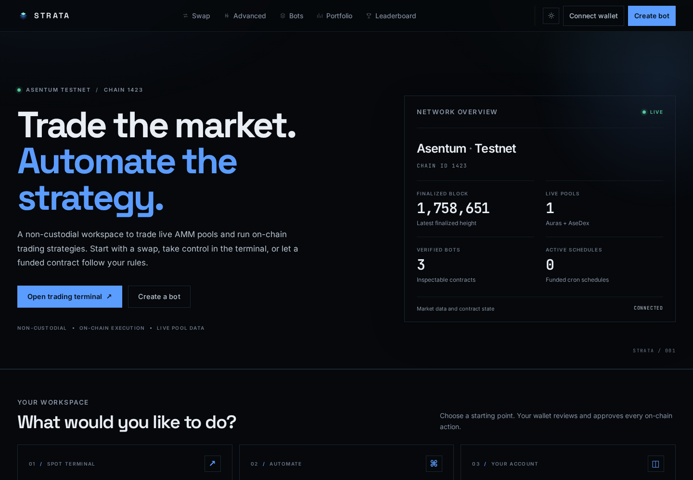
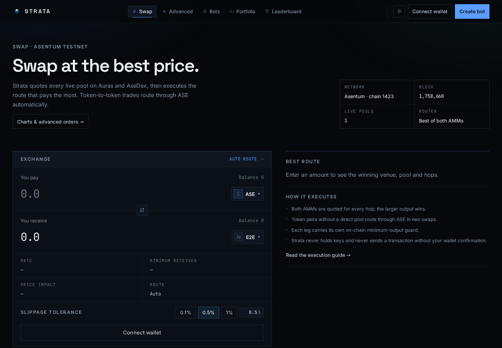
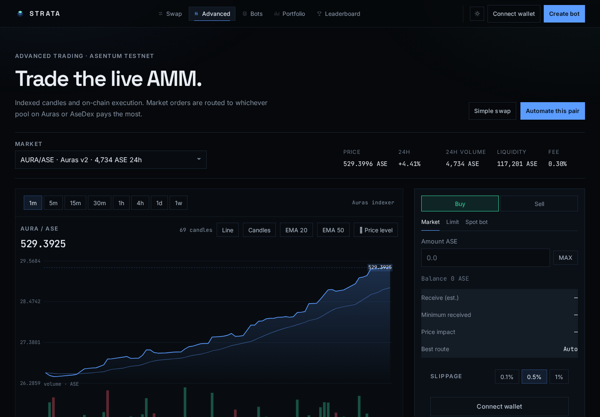
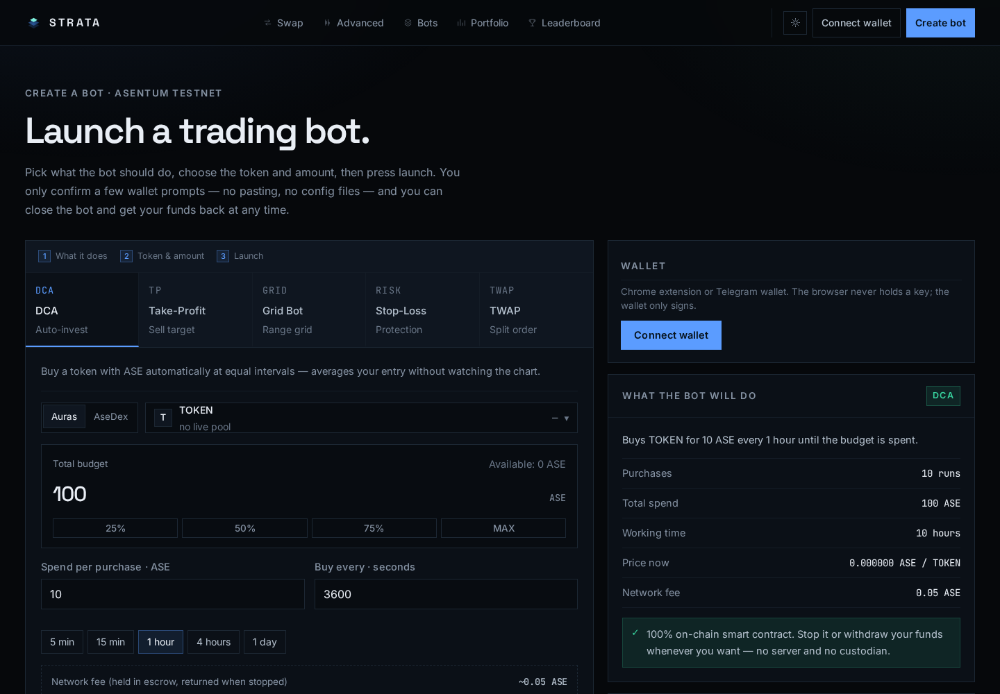
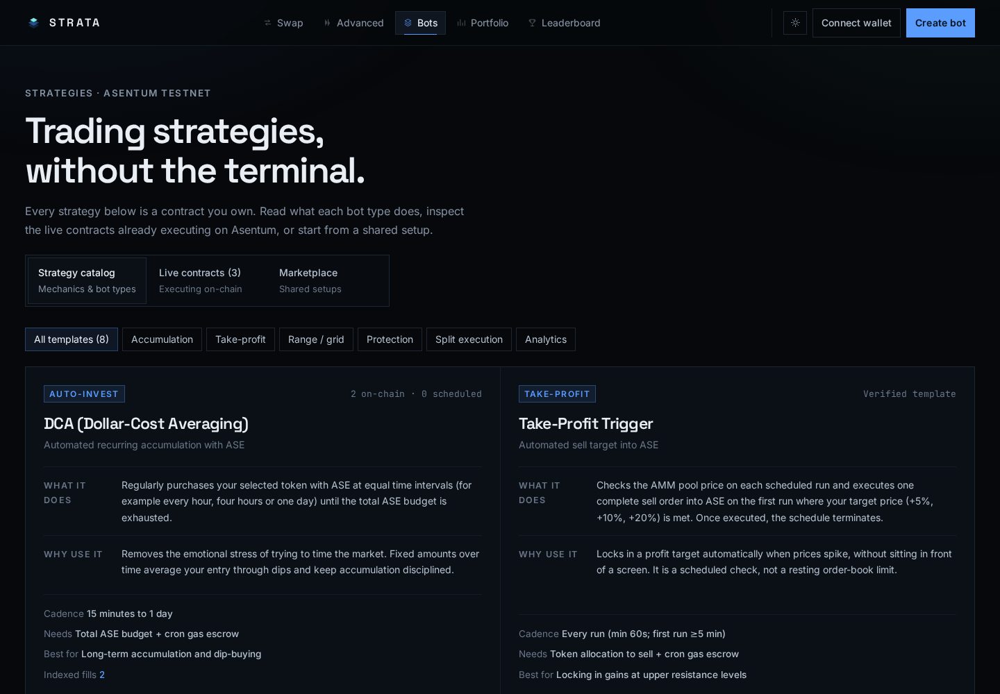
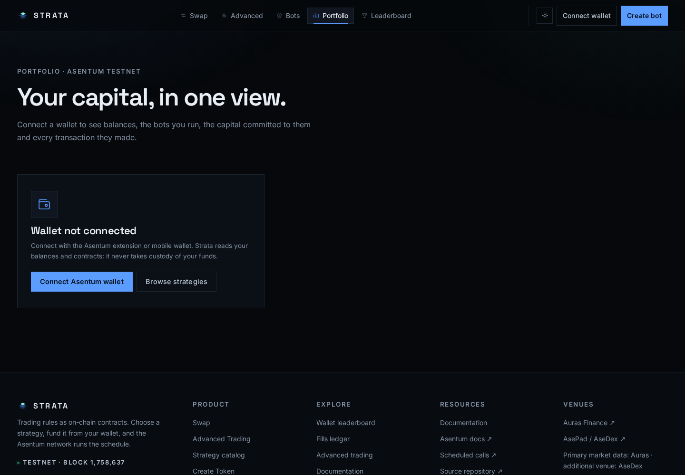
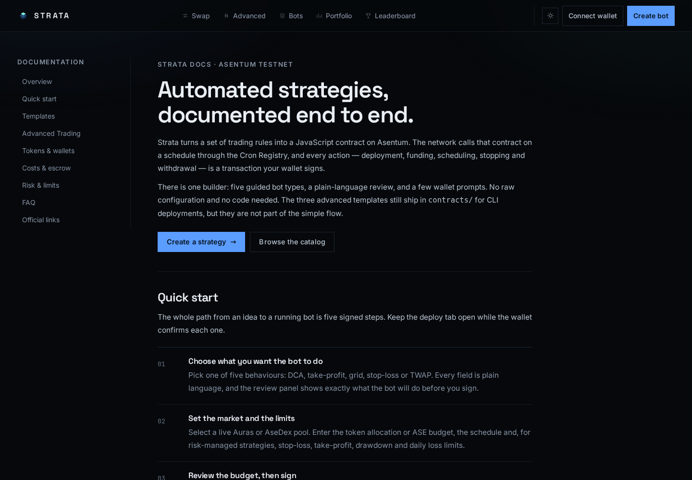

<div align="center">

# STRATA

### Autonomous On-Chain Trading Strategies on Asentum

[](https://stratadex.site/)
[](https://explorer.asentum.com)
[](#-security--privacy)
[](#-privacy-and-user-protection)
[](LICENSE)

<br/>

**Strata** is an autonomous trading protocol where strategies run directly on the blockchain as smart contracts rather than fragile off-chain bots.
Deployed once, scheduled by the blockchain protocol itself, and verified through public on-chain source code.

[🌐 Open Web App](https://stratadex.site) · [Protocol Contracts](#-system-contracts--network) · [How It Works](#-how-it-works) · [Strategy Templates](#-core-strategy-archetypes) · [Security & Privacy](#-privacy-and-user-protection)

</div>

---

## 🔭 What is Strata?

In traditional automated trading and DeFi, running an automated strategy requires hosting an off-chain bot on a private VPS, setting up API keys, managing cron jobs, and constantly monitoring server uptime. If the server crashes or loses internet connectivity at 3:00 AM, the strategy fails.

**Strata completely changes this paradigm on the Asentum blockchain.**

On Asentum, trading logic is authored as a native JavaScript smart contract and registered with the blockchain's native **protocol cron registry**. The network's block builders trigger execution at specified block intervals natively:

- **100% On-Chain:** Strategy logic lives permanently on the blockchain.
- **Protocol-Scheduled:** Execution is triggered directly by block builders (`cron.schedule()`). No external keeper bots, VPS hosting, or keeper subscriptions.
- **DEX-Integrated:** Prices and liquidity are queried directly from the **Auras AMM** TWAP (Time-Weighted Average Price) accumulators, eliminating external oracle reliance.
- **Transparent & Auditable:** Source code is stored on-chain and verified in the browser using BLAKE3 cryptographic hashes.
- **Fully Serverless:** The web application is a static client that talks directly to the blockchain RPC without any intermediate backend servers.

---

## 🏛️ System Contracts & Network

Strata interacts with the following verified protocol contracts on the **Asentum Testnet**:

| Parameter / Contract | Address / Value | Details |
|---|---|---|
| **Network** | Asentum Testnet | Chain ID: `1423` (2s block time) |
| **Public RPC Gateway** | `https://explorer.asentum.com` | Official Asentum testnet RPC / node API (chain ID 1423) |
| **Block Explorer** | `https://explorer.asentum.com` | Official Asentum ledger & block explorer |
| **Auras AMM v2 (live)** | [`0xcc1c9029cfe92004bca76c013cef2fdaa75351a2`](https://explorer.asentum.com/address/0xcc1c9029cfe92004bca76c013cef2fdaa75351a2) | Current Auras pools, quotes and swaps (shipped 10 Nov 2026) |
| **Auras AMM v1 (legacy)** | [`0x63f640a9b98b6f28e06cb5cc0fce5d72b6c0eabd`](https://explorer.asentum.com/address/0x63f640a9b98b6f28e06cb5cc0fce5d72b6c0eabd) | Old pools; only LPs that have not migrated still trade there |
| **Protocol Cron Registry** | `0x0000000000000000000000000000000000000006` | Built-in system contract for autonomous scheduling |
| **Native ASE Sentinel** | `0xeeeeeeeeeeeeeeeeeeeeeeeeeeeeeeeeeeeeeeee` | Standard identifier for the native ASE asset leg |
| **Strata Hub Contract** | [`ase1utdzul2gxdw4c60fr7fcphghlak63sjf8mqnut`](https://explorer.asentum.com/address/ase1utdzul2gxdw4c60fr7fcphghlak63sjf8mqnut) | Canonical protocol contract for strategy registration, escrow, & airdrop telemetry |
| **Protocol Deployer Wallet** | [`ase1aluuy3j3q0xc6dqmc5amjzn0x4tt9sl606h5et`](https://explorer.asentum.com/address/ase1aluuy3j3q0xc6dqmc5amjzn0x4tt9sl606h5et) | Official protocol treasury & deployer address on Asentum Testnet |

---

## ⚙️ How It Works

```
        ┌────────────────────────────────────────────────────────┐
        │                 Asentum Blockchain                     │
        │                                                        │
        │  ┌──────────────────────┐    Every N seconds           │
        │  │ Protocol Cron Engine │ ─────────────────────┐       │
        │  │ (0x00...0006)        │                      │       │
        │  └──────────────────────┘                      │       │
        │                                                ▼       │
        │                                    ┌────────────────┐  │
        │           consult(poolId)          │ Strategy       │  │
        │      ┌───────────────────────────  │ Smart Contract │  │
        │      │                             │ (JavaScript)   │  │
        │      ▼                             └───────┬────────┘  │
        │  ┌──────────────────────┐                  │           │
        │  │ Auras AMM            │                  │           │
        │  │ (0x63f6...0eabd)     │ ◄────────────────┘           │
        │  │ TWAP & Spot Reserves │    swapExactIn(token → ASE)  │
        │  └──────────────────────┘    (if trigger condition)    │
        └────────────────────────────────────────────────────────┘
```

1. **Self-Scheduling:** When a strategy contract is initialized (`init`), it calls `cron.schedule()` with its execution interval, gas escrow, and parameters.
2. **Autonomous Execution:** With every passing interval, the block builder executes the contract's `tick()` method inside the block generation cycle.
3. **Price Consultation:** The contract inspects real-time reserves and TWAP from Auras AMM via asynchronous cross-contract call (`E(AURAS).consult(poolId)`).
4. **Trigger Evaluation:** The contract computes price drift vs. configured thresholds. If conditions match, it dispatches an atomic swap (`swapExactIn`).
5. **Event Emission:** Every signal (`buy`, `sell`, `hold`) and trade fill emits an on-chain indexed event (`Signal`, `Fill`), visible across the explorer and Strata dashboard.

---

## 🛡️ Privacy and User Protection

### 🔒 No Server-Side Wallet Database
- **No backend database:** Strata has **no database, no account API and no server-side wallet table**, so there is no endpoint that can list users' addresses.
- **Local bookkeeping only:** Strategies deployed from this browser are kept in `localStorage`, keyed by the owner address, so the app can show its own deployments. Swap history is local too. This data never leaves the browser and can be cleared by the user.
- **Optional wallet registry:** Portfolio has an opt-in registry that remembers public addresses in this browser only. It is off by default, states its purpose, and deletes every entry when switched off. It never stores keys, seeds, balances or activity. See `src/lib/walletRegistry.ts`.
- **Zero Analytics / Telemetry:** No third-party trackers, Google Analytics, cookies, or user fingerprinting scripts are embedded.
- **Client-Side Only:** All chain queries go directly to the official Asentum RPC at `https://explorer.asentum.com`; Auras market pairs, candles and trade tape come from the Auras indexer at `https://auras.asentum.com`. The explorer API is reached through a read-only same-origin proxy (`/api/explorer`) because it sends no CORS headers; that proxy does not log or store address data in this app.

### 🧾 Optional Wallet Registry
- No server-side wallet database exists in this app.
- The optional Wallet Registry is disabled by default and stores only public addresses in the current browser after explicit opt-in.
- Opting out clears the saved list. No keys, seed phrases or signatures are stored.

### 🔑 Non-Custodial Architecture
- **Keys Never Leave Your Device:** Connections occur via `@asentum/connect` using either the official Chrome extension or the Telegram wallet bot.
- **Signing Only:** The web interface never generates, accesses, requests, or stores private keys or seed phrases. Your wallet only approves and cryptographically signs transactions.
- **BLAKE3 Source Integrity:** Before interacting with or funding any strategy, the web client computes the `blake3` hash of the contract's source code and verifies it against the `codeHash` stored on the blockchain. Any tampering or bytecode divergence is immediately flagged.
- **Isolated Gas Escrow:** Strategy executions are prepaid through a dedicated gas escrow. If a user decides to deactivate a strategy, the cron job is cancelled and remaining escrow is returned.

---

## 📊 Core Strategy Archetypes

The app ships eight on-chain templates. Five trader-facing presets are available in the bot builder; the remaining three stay available in the contract catalog and the strategy contracts themselves.

| Strategy | Default cadence | Direction / behaviour | Funding |
|---|---:|---|---|
| **Momentum Signal** | 60 sec | Signal only; compares TWAP windows and emits buy / sell / hold. No trade. | Cron gas escrow |
| **Momentum Trader** | 60 sec | Sells the selected ARC-20 token into ASE when its momentum condition is met. | Token allocation + escrow |
| **Grid** | 60 sec | Two-sided AMM grid: token inventory for sells and ASE reserve for buys. | Tokens + ASE reserve + escrow |
| **TWAP Slicer** | 300 sec | Splits one token-to-ASE sale into timed atomic swaps. | Token allocation + escrow |
| **DCA** | 3,600 sec | Repeated ASE-to-token spot buys until the budget is used. | ASE buy budget + escrow |
| **Risk-managed Trader** | 300 sec | Scheduled, sell-only spot strategy with stop-loss, take-profit and drawdown checks. | Token allocation + escrow |
| **Limit Sell Trigger** | 60 sec | One scheduled reduce-only sale when the pool price reaches the trigger; not a resting order-book order. | Token allocation + escrow |
| **Scale Order** | 60 sec | Scheduled reduce-only sales across price levels; not a resting order-book order. | Token allocation + escrow |

Cadence is the on-chain schedule, not a continuous price feed. Asentum Cron supports a minimum interval of 60 seconds. Price triggers are checked only when a scheduled run executes.

---

## 🖥️ Web Application Features

The live application at [**stratadex.site**](https://stratadex.site) provides a comprehensive terminal for on-chain automated strategies:

### 1. Live Dashboard & AMM Tape
- Real-time block heights (finalized head and tip).
- Live Auras AMM pool reserves, liquidity, and token quotes.
- Live on-chain transaction tape showing real-time swaps and strategy triggers.



### 2. Best-Price Swap & Advanced Trading

The Swap screen quotes every live pool on both Auras and AseDex, then executes the route that pays the most. Token-to-token trades route through ASE automatically, and each hop carries its own on-chain minimum-output guard.



The Spot ticket supports Market, supported Auras v2 escrowed Limit orders, and Bot mode. Bot mode deploys an existing spot strategy contract for the selected pool. Stop-loss/take-profit are scheduled spot exit conditions, not Perps positions. Chart controls include EMA 20/50 and locally saved horizontal price levels. Switching to the **AsePad Perps** tab connects directly to [`perps.asepad.fun`](https://perps.asepad.fun/) contracts (`0x37d25f3a292f0642af72d6f161eafb18c76e16a6`) for leveraged Long/Short markets, Vault collateral, direct keeper orders (TWAP/DCA, Scale, Limit+TP/SL, Trailing Stop, Stop/TP) and six autonomous Perps Cron bot contracts.

- Pair selector over live ASE pools, with indexed 24h price, volume and liquidity.
- Candlestick chart from real indexed Swap events: 1m, 5m, 15m, 30m (2×15m), 1h, 4h, 1d and 1w (7×1d). Zoom, pan, hover OHLC and volume.
- Market orders are quoted by the AMM contract and signed by the wallet with a minimum-output guard.
- Limit orders are genuine escrowed Auras v2 orders (`createLimitOrder` / `cancelLimitOrder`), filled against the pool by cron. They are not presented as an order book, and AseDex / legacy Auras v1 pools are market-order only because the module is deployed beside Auras v2.
- Every chart and price is normalised to ASE per token, including pools where ASE is token0.
- Open orders, balances and the live trade tape are read from chain state / the Auras indexer. The selected on-chain pool ID and venue are carried into the bot builder so a bot can be created for the market being viewed.
- AsePad Perps reads live markets, mark prices, funding indices, Vault collateral, open positions and native orders from chain state and delegates signing to the user's wallet.



### 3. Create Token
- Deploys a fixed-supply ARC-20 contract, then calls `init` once to mint the supply to the deployer.
- Shows the contract address, both transaction hashes and a chain-read verification of name, symbol, decimals and supply.
- A failed initialisation resumes against the same deployed address instead of deploying a second token.

### 4. Bot Builder, Strategy Registry & Hash Verifier
- One guided builder for the five trader-facing bots: DCA, take-profit, grid, stop-loss and TWAP.
- Automatic discovery of on-chain strategy contracts carrying the Strata signature.
- Instant client-side **BLAKE3 source code verification** against on-chain bytecode hashes.
- Real-time monitoring of contract token balances, remaining gas escrow, and execution history.
- Portfolio can finish an interrupted token deposit on an already initialized contract instead of deploying a duplicate.





### 5. Portfolio & Position Tracking
- Wallet balances, capital committed to bots, realised proceeds and local transaction history.
- Bots grouped by lifecycle state: running, funded, needs setup and stopped.
- Close a bot to cancel its schedule and return ASE and tokens; unfinished contracts can be removed from the local list without touching the chain.



### 6. Interactive Mechanics & Visualizer (`/how`)
- Interactive threshold simulator demonstrating how price drift triggers `buy` / `hold` / `sell` signals in real time.
- Documentation of Asentum VM execution limits and cross-contract calling rules (`E()` primitives).



---

## ⚖️ Bot vs. On-Chain Contract Comparison

| Feature | Centralized Trading Bot | Strata On-Chain Strategy |
|---|---|---|
| **Execution Environment** | Centralized VPS / Home PC | Directly inside blockchain block creation |
| **Execution dependency** | Depends on the operator's server and network | Runs when the Asentum Cron Registry schedules it; chain congestion and failed runs still matter |
| **Scheduler** | Server `cron` daemon or commercial keeper | Protocol-level system registry (`cron.schedule`) |
| **Code Transparency** | Closed-source or private on a server | 100% public source code verified on-chain |
| **Tamper Resistance** | Server owner can modify logic anytime | Code is immutable once deployed |
| **Price Data Source** | External APIs or private websockets | Strategy-specific AMM reads/TWAP; chart candles come from indexed AMM Swap events |
| **Security Risk** | API keys and private keys stored on server | Non-custodial, no server keys exist |

---

## 🧪 Verification

The repository ships repeatable checks instead of manual server setup:

```bash
npm run typecheck
npm run lint
npm run build
npm run test:strategies
npm run test:trading
```

`test:strategies` checks template upgrades and contract invariants. `test:trading` simulates complete strategy lifecycles, including fills, budget exhaustion and scheduled exits. Live-chain transaction checks still require testnet access and explicit wallet approval.

The frontend is a static Vite/React client. It reads Asentum and market-indexer data directly from the browser and delegates signing to the connected Asentum wallet. There is no backend, database or server-side wallet state.

For current feature behaviour and limitations, see [docs/PRODUCT_GUIDE.md](docs/PRODUCT_GUIDE.md). For system boundaries and data flow, see [docs/ARCHITECTURE.md](docs/ARCHITECTURE.md).

---

## 📄 License & Ecosystem

- **Protocol:** Built on [Asentum](https://www.asentum.com) (Chain ID `1423`).
- **DEX Venue:** [Auras AMM](https://auras.finance).
- **License:** Open source under the [MIT License](LICENSE).
- **Security Policy:** Detailed disclosure guidelines available in [SECURITY.md](SECURITY.md).
