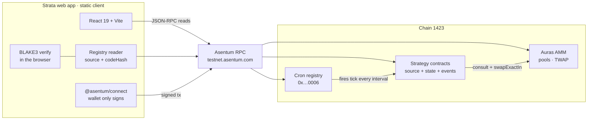
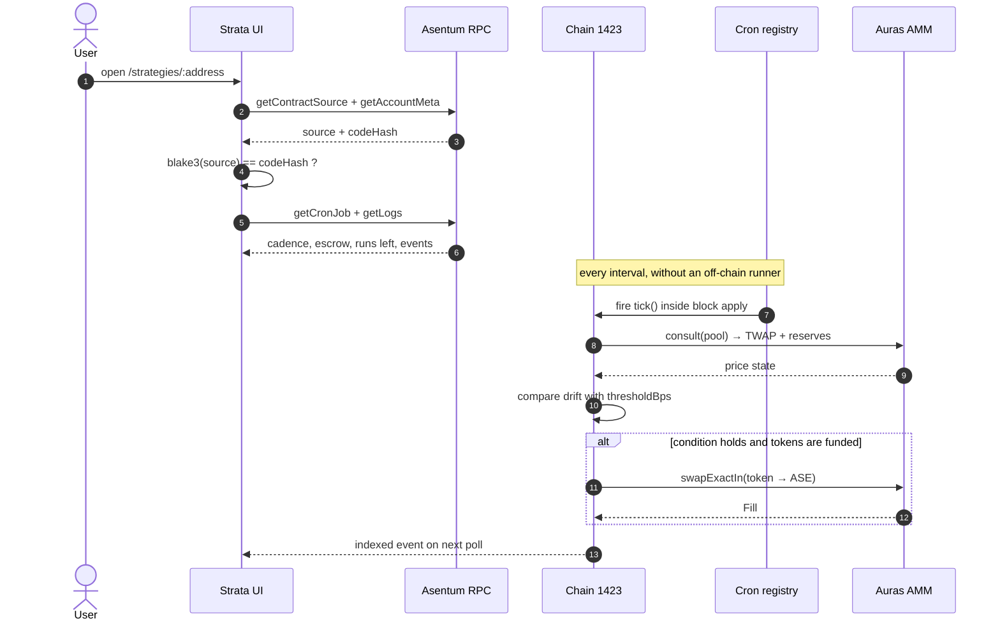
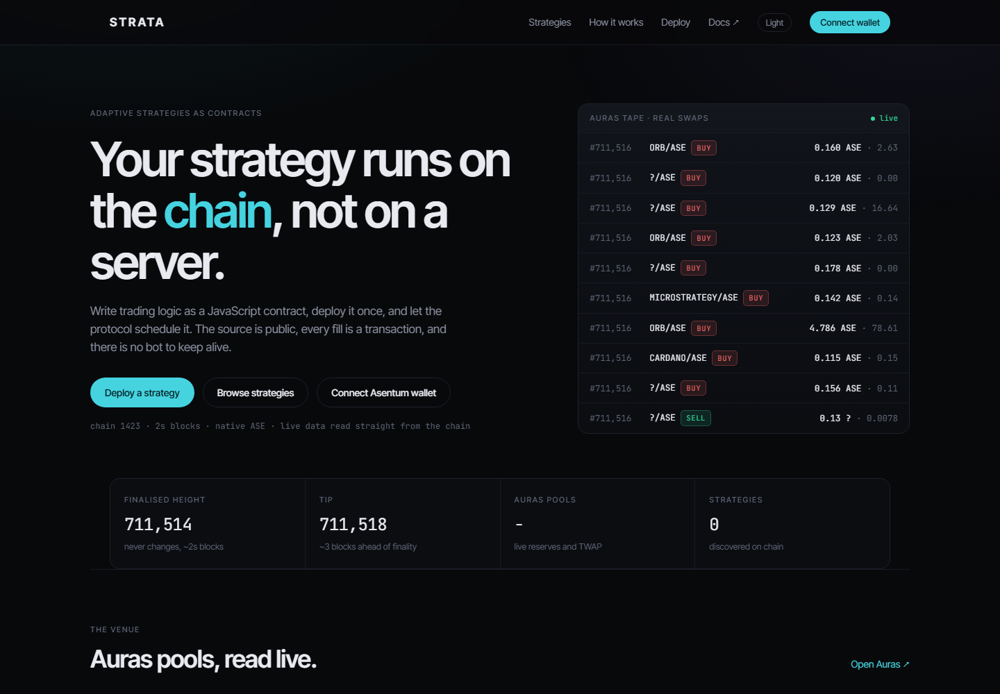
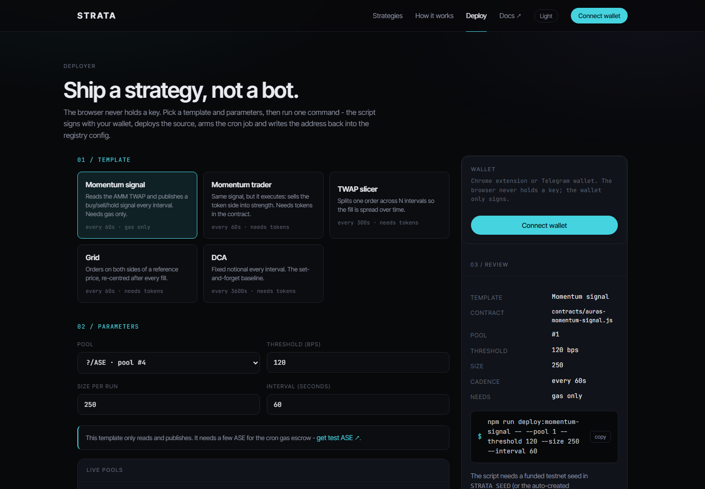
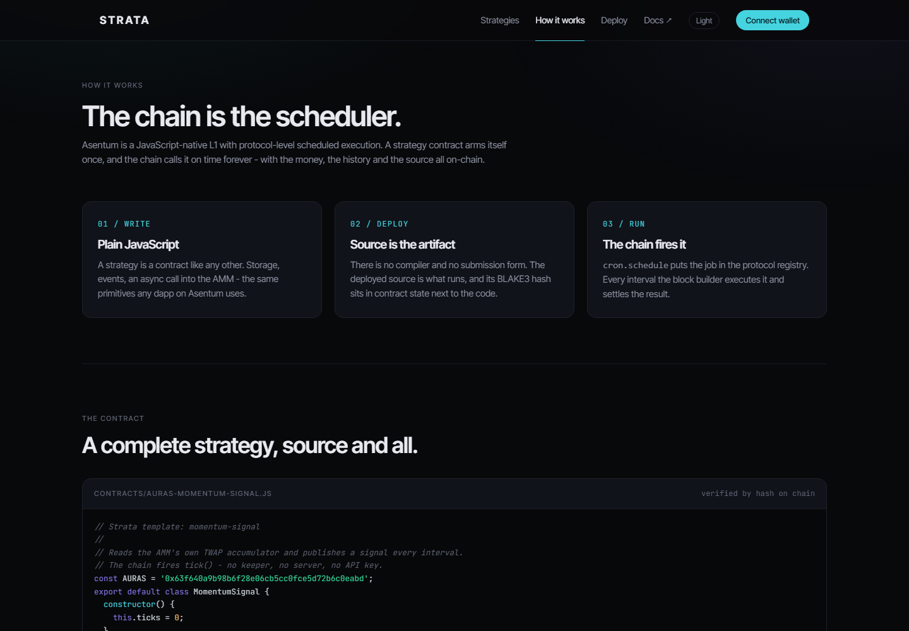

<div align="center">

# STRATA

### Trading strategies as contracts on Asentum

[](https://strata-inky-sigma.vercel.app)
[](https://explorer.asentum.com)
[](https://github.com/Juniorj87/strata/actions/workflows/ci.yml)
[](LICENSE)
[](contracts/)
[](src/)
[](#-architecture)

**Write trading logic as a JavaScript contract, deploy it once, and let the chain schedule it.**
The source is public, every fill is a transaction, and there is no bot process to keep alive.

[🚀 Live App](https://strata-inky-sigma.vercel.app) · [How it works](#-how-it-works) · [Routes](#-routes) · [Architecture](#-architecture) · [Templates](#-strategy-templates) · [Deploy](#-deploy-a-strategy) · [Security](SECURITY.md) · [Contributing](CONTRIBUTING.md)

</div>

---

## 📑 Table of Contents

- [Overview](#-overview)
- [Why a contract, not a bot](#-why-a-contract-not-a-bot)
- [What is in the app](#-what-is-in-the-app)
- [Routes](#-routes)
- [How it works](#-how-it-works)
- [Architecture](#-architecture)
- [Execution lifecycle](#-execution-lifecycle)
- [Strategy templates](#-strategy-templates)
- [Contract primitives](#-contract-primitives)
- [Deploy a strategy](#-deploy-a-strategy)
- [Project structure](#-project-structure)
- [Run locally](#-run-locally)
- [Screenshots](#-screenshots)
- [Security and verification](#-security-and-verification)
- [Project status](#-project-status)
- [Contributing](#-contributing)

---

## 🔭 Overview

Protocols like Auras give you an AMM. They do not give you a scheduler. The usual answer is a bot on a VPS,
an API key, a keeper service and a process that quietly dies at 3 a.m.

Strata removes that layer. On Asentum, a contract can register itself with the protocol cron registry and the
**block builder calls it on time, forever**:

| | |
|---|---|
| **Logic lives on chain** | The deployed JavaScript source is the artifact. No compiler, no ABI, no build step. |
| **The chain is the scheduler** | `cron.schedule()` writes a job into the protocol registry. No keeper, no server, no API keys. |
| **Every decision is public** | Each tick emits an indexed event. The registry and the explorer read the same source. |
| **Anyone can verify before funding** | `blake3(source)` is compared with the on-chain `codeHash` in the browser. |
| **The venue is the AMM** | Price data comes from Auras' own TWAP accumulator, not from a private oracle feed. |

> [!NOTE]
> Strata runs on **chain 1423 (Asentum testnet)** and reads state directly from `testnet.asentum.com`.
> There is no backend to deploy: the browser talks to the chain.

---

## 🆚 Why a contract, not a bot

| | Off-chain bot | Strata contract |
|---|---|---|
| Where the logic lives | A server you control | On chain, source published |
| Runs while your laptop sleeps | No | Yes - the chain fires it |
| Scheduler | Cron job or a keeper service | Protocol-level cron registry |
| Cost to stay alive | Hosting + API keys | Gas escrow per job |
| Audit before you trust it | Ask the operator | Read the source, verify the hash |
| Kill switch | Kill the process | Cancel the scheduled job |
| Price data | Your API key, your risk | The AMM's own TWAP accumulator |

---

## 🧩 What is in the app

- **Live dashboard** - Auras pool reserves, spot quotes, the real swap tape and chain heads, refreshed from RPC.
- **On-chain registry** - every contract whose source carries the `Strata template:` marker, plus manually
  configured addresses. Each entry shows verified source, cron job state, balance and execution log.
- **Strategy detail** - full source read from the node, BLAKE3 check against `codeHash`, fills, volume, realised
  amount, cron cadence, next run and the raw event feed.
- **Deployer** - pick a template, tune pool, threshold, size and interval, then copy the exact CLI command.
  The browser never holds a key.
- **Interactive walkthrough** on `/how` - move the threshold and watch one `tick()` decide `buy` / `hold` / `sell`.
- **Wallet connect** - Chrome extension or Telegram bot wallet via `@asentum/connect`. The wallet only signs.

---

## 🗺️ Routes

| Route | View | Reads from chain | What you do there |
|---|---|---|---|
| `/` | Dashboard | heads, tape, Auras pools, strategies | See live venue state and deployed strategies |
| `/strategies` | Registry | contract source, `codeHash`, balance, logs | Audit every strategy the app can find |
| `/strategies/:address` | Strategy detail | source, cron job, events, fills | Verify the hash, read the tick history |
| `/deploy` | Deployer | pools | Choose a template and generate the deploy command |
| `/how` | Docs | static | Contract model, VM limits, interactive walkthrough |
| any unknown path | Dashboard | same as `/` | Fallback route |

All data is read client-side from the Asentum RPC. `src/config/strategies.json` is the only local seed list;
anything else is discovered by scanning recent deployments for the Strata marker.

---

## ⚙️ How it works

Asentum is a JavaScript-native L1 with protocol-level scheduled execution. A strategy contract arms itself
once with `cron.schedule(...)`, and the block builder executes it every interval.

```
        ┌────────────┐   deploy source   ┌────────────┐
        │  you (cli) │ ───────────────► │  contract  │  source + BLAKE3 hash
        └────────────┘                  └─────┬──────┘
                                               │ init(pool, token, threshold, interval)
                                               ▼
                                        ┌────────────┐
                                        │ cron job   │  interval, gas escrow
                                        └─────┬──────┘
                                              │ every interval
                                              ▼
   ┌──────────┐   consult(pool)   ┌────────────┐   Signal/Fill   ┌──────────┐
   │  Auras   │ ◄─────────────── │   tick()   │ ──────────────► │ explorer │
   │   AMM    │  TWAP + reserves │  decision  │                 │  events  │
   └──────────┘                  └─────┬──────┘                 └──────────┘
                                        │ if condition holds
                                        ▼
                                  swapExactIn(token → ASE)   via E()
```

Two constraints worth knowing before deploying one:

| | |
|---|---|
| Which side it can trade | The **token side only**. `E()` carries no value, so strategies sell the ARC-20 leg into ASE. |
| Deployment model | Plain JS source, no compiler. `blake3(source)` must equal the on-chain `codeHash`, or the registry flags it. |

---

## 🏗️ Architecture

The whole product is a static client. Reads and wallet signing go straight to the node; nothing is proxied
through a server we operate.



| Layer | Stack | Responsibility |
|---|---|---|
| UI | React 19, React Router 7, Vite | Routes, panels, live tape, registry views |
| Chain client | `src/lib/rpc.ts` - plain `fetch` | JSON-RPC reads, hashing, explorer links |
| Program logic | `src/lib/registry.ts` | Build strategy records from source, meta, logs, cron state |
| Contracts | Plain JavaScript | Trading logic and self-scheduling |
| Deployer | Node scripts + `@asentum/sdk` | Sign, broadcast, arm cron, verify hash, write config |

More detail: [`docs/ARCHITECTURE.md`](docs/ARCHITECTURE.md).

---

## 🔄 Execution lifecycle



A failed leg reverts the whole tick. A succeeded tick is a normal transaction with a normal receipt - there is
no separate "bot log" to trust.

---

## 📦 Strategy templates

Seven contracts live in [`contracts/`](contracts). Five are wired into the deployer.

| Template | File | Cadence | Logic | Funding |
|---|---|---|---|---|
| Momentum signal | `auras-momentum-signal.js` | 60s | Reads TWAP, publishes `buy` / `hold` / `sell` | Gas only |
| Momentum trader | `auras-momentum-trader.js` | 60s | Same signal, executes the token-side swap | Gas + ARC-20 |
| TWAP slicer | `twap.js` | 300s | Splits one order across N legs | Gas + ARC-20 |
| Grid | `grid.js` | 60s | Two-sided orders around a reference price | Gas + ARC-20 |
| DCA | `dca.js` | 3600s | Fixed notional every interval | Gas + ARC-20 |
| Mean reversion | `mean-reversion.js` | 120s | Sells into strength, buys back on weakness | Gas + ARC-20 |
| Momentum | `momentum.js` | 60s | Reference implementation of the momentum idea | Gas + ARC-20 |

Deployable from the CLI today: `momentum-signal`, `momentum-trader`, `twap`, `grid`, `dca`.
See [`contracts/README.md`](contracts/README.md) for parameter notes and the placeholder-address caveat.

---

## 🧱 Contract primitives

```javascript
cron.schedule(target, method, args, nextRunAt, intervalSec, maxRuns, gasLimit)
// Registers a job in the protocol cron registry. The block builder fires it
// inside block apply - no keeper, no off-chain runner.

E(addr).method(args)
// Asynchronous cross-contract call. A strategy cannot be re-entered mid-execution,
// and a failed leg reverts the whole tick.

emit(name, payload)
// Indexed event. The registry, the explorer and any indexer read these.

storage.set(key, value) / storage.get(key)
// Per-contract state: armed parameters, job id, tick counter, history.

msg.sender
// Scheduled calls arrive with the zero address as sender. Gate anything that
// should only run from a user transaction.
```

Hard limits in VM v0.8.1 - all of them are visible on `/how`:

- `E()` carries no value, so a contract cannot open the native side of a swap.
- `E()` does not work inside view methods.
- No `Date.now()` and no `Math.random()`; use `msg.block.timestamp`.
- Library approval is disabled by governance, so the source must be self-contained.

---

## 🚀 Deploy a strategy

The deployer runs locally, creates or reuses a signing seed in git-ignored `.strata/seed.json`
(or reads `STRATA_SEED`), broadcasts to chain 1423, arms the cron job and verifies the source hash.

```bash
npm run deploy:momentum-signal -- --pool 1 --threshold 120 --interval 60
```

| Command | What it deploys |
|---|---|
| `npm run deploy:momentum-signal` | Signal-only momentum strategy |
| `npm run deploy:momentum-trader` | Momentum strategy that trades the token side |
| `npm run deploy:twap` | TWAP slicer |
| `npm run deploy:grid` | Grid around a reference price |
| `npm run deploy:dca` | Fixed-notional DCA |

Flow:

1. **Install** - `npm install`
2. **Fund** - the script prints the generated address; the faucet is at `airdrop.asentum.com`
3. **Deploy** - run one of the commands above with `--pool`, `--threshold`, `--size`, `--interval` as needed
4. **Verify** - if `blake3(sent source)` differs from the on-chain `codeHash`, the registry marks it unverified
5. **Fund trading templates** - the contract itself needs ARC-20 tokens before its first fill; the signal-only
   template runs on the cron escrow alone

---

## 🗂️ Project structure

```text
strata/
├── .github/
│   ├── CODEOWNERS
│   └── workflows/ci.yml        # lint · build · type-check · contract syntax · audit
├── contracts/                  # plain-JS strategy templates
│   ├── auras-momentum-signal.js
│   ├── auras-momentum-trader.js
│   ├── twap.js · grid.js · dca.js
│   ├── momentum.js · mean-reversion.js
│   └── README.md
├── docs/
│   ├── ARCHITECTURE.md         # system design and data flow
│   ├── auras-contract.txt      # reference copy of the AMM surface
│   └── screenshots/            # images used by this README
├── scripts/
│   ├── deploy.ts               # sign · deploy · arm cron · verify · write config
│   ├── check-chain.ts          # sanity-check every RPC surface the app uses
│   └── check-verify.ts         # BLAKE3 verification against the live contract
├── src/
│   ├── components/             # Shell, Tape, PoolGrid, StrategyCard, Walkthrough…
│   ├── lib/                    # rpc.ts, registry.ts, formatting, hooks, theme
│   ├── pages/                  # Home · Strategies · StrategyDetail · Deploy · How
│   ├── config/strategies.json  # local seed list for the registry
│   ├── App.tsx · main.tsx · styles.css · types.ts
├── SECURITY.md · CONTRIBUTING.md · BUGS.md · LICENSE
└── index.html · package.json · vite.config.ts
```

---

## ⚡ Run locally

No backend, no database, no API keys. The app reads the chain directly.

```bash
git clone https://github.com/Juniorj87/strata.git
cd strata
npm install
npm run dev          # http://127.0.0.1:5173
```

Other commands:

```bash
npm run build        # type-check + production bundle into dist/
npm run lint         # oxlint
npm run preview      # serve the production build
npm run chain:check  # sanity-check every RPC surface the app uses
npm run chain:verify # BLAKE3 verification against the live Auras contract
```

Deploying to static hosting only needs `dist/`. There is nothing server-side to configure.

---

## 🖼️ Screenshots

**Dashboard - live pools, tape, chain heads, registry**



**Deployer - template, parameters, exact CLI command**



**How it works - contract source, VM limits, interactive walkthrough**



---

## 🛡️ Security and verification

- **No key custody** - the web app never generates or stores a private key. Wallet connect only signs.
- **Hash verification in the browser** - the deployed source is fetched and hashed locally, then compared with
  the contract's `codeHash`. Mismatch is shown as `✗ hash mismatch`, not hidden.
- **No proxy** - all reads go directly to the public RPC gateway; there is no server that could silently rewrite
  data on the way.
- **Local deploy seed** - `.strata/seed.json` is git-ignored; CI never receives it. `STRATA_SEED` is optional.
- **Testnet only** - chain 1423 is a testnet. Contracts are not audited. Do not point this at funds you cannot
  lose.

Full policy and disclosure process: [`SECURITY.md`](SECURITY.md).

---

## 📌 Project status

| Area | State |
|---|---|
| Web app | Working: dashboard, registry, detail, deployer, walkthrough |
| Chain reads | Live against `testnet.asentum.com` |
| Contracts | Templates written and syntax-checked in CI; not audited, not exercised on mainnet |
| Registry | Empty by default - the app discovers deployments carrying the `Strata template:` marker |
| Wallet | Chrome extension and Telegram bot wallet via `@asentum/connect` |
| Backend | None, by design |

Known gaps are tracked in [`BUGS.md`](BUGS.md). The honest summary: the model is complete, the templates need
a funded testnet run before anyone should treat their behaviour as proven.

---

## 🤝 Contributing

Issues and pull requests are welcome - new templates, UI work, docs and testing especially.

```bash
npm install
npm run lint
npm run build
```

Every PR must pass `npm run lint` and `npm run build`; the workflow in
[`.github/workflows/ci.yml`](.github/workflows/ci.yml) also checks TypeScript and contract syntax.
Read [`CONTRIBUTING.md`](CONTRIBUTING.md) first. Security reports go through [`SECURITY.md`](SECURITY.md).

---

<div align="center">

**Strata** - the chain is the scheduler, the AMM is the venue, the source is public.

MIT licensed · built on [Asentum](https://www.asentum.com)

</div>
