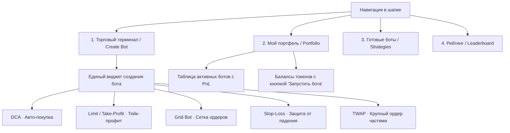

# 📐 ТЕХНИЧЕСКОЕ ЗАДАНИЕ (ПРОМПТ ДЛЯ DEEPSEEK): РЕБРЕНДИНГ И UX/UI ОВЕРХОЛ STRATA

> **Кому:** Модели искусственного интеллекта (DeepSeek / Claude / GPT) для реализации нового интерфейса.  
> **Проект:** Strata — платформа децентрализованных торговых ботов на блокчейне Asentum.  
> **Текущий стек:** React 19, TypeScript, Vite, `@asentum/connect`, чистый CSS (`src/styles.css`).  
> **Главная задача:** Полностью переработать пользовательский опыт (UX/UI) сайта. Сделать его максимально простым, привычным и понятным для любого крипто-пользователя (по стандартам Uniswap, Bybit Trading Bots, 1inch, Jupiter DCA), сохранив при этом существующую визуальную эстетику (цвета, шрифты, тёмная тема) и 100% работоспособность смарт-контрактов и блокчейн-логики.

---

## 1. Концепция и ключевые правила ребрендинга

### ❌ Что сейчас не так (проблема пользователя):
1. **Сложная терминология «для блокчейн-разработчиков»:**
   - Пользователь видит: *`Threshold: 120 bps`*, *`Cron gas escrow: 0.05 ASE`*, *`Slices: 6`*, *`Levels: 5`*, *`Cost basis wei`*.  
   - Обыватель не понимает, что такое «bps» (базисные пункты), зачем ему высчитывать «escrow» и как настроить простой тейк-профит.
2. **Перегруженные экраны:**
   - Форма создания бота оторвана от баланса и графика, содержит десятки полей сразу.
   - Детали стратегии перегружены сырым кодом JS, логами и хешами, за которыми не видно главного — кнопок управления своими деньгами.
3. **Непривычный флоу:**
   - На современных DEX (Jupiter, Bybit, Uniswap) пользователь сначала видит понятный виджет: **«Что у меня есть» ➔ «Что сделать» ➔ «Сумма» ➔ «Запустить»**.

###  Как должно быть (решение):
1. **Визуальный стиль сохраняем строго:**
   - Цветовая палитра из [src/styles.css](file:///E:/%D0%A1%D0%B0%D0%B9%D1%82%D1%8B/Asentum%20for%20github/src/styles.css):
     - Фон: `--bg: #08090b`, карточки: `--surface: #101319`, границы: `--line: #1e222b`.
     - Основной акцент: бирюзовый `--accent: #45d3e0`.
     - PnL / индикаторы: зеленый `--up: #35d69a`, красный `--down: #ff6b6b`.
     - Шрифты: `Inter Tight` (UI) и `JetBrains Mono` (числа, адреса, хэши).
2. **Язык интерфейса — понятный трейдеру:**
   - Вместо `bps` ➔ проценты `%` (например, `100 bps` = `1%`).
   - Вместо `slices` ➔ `Количество ордеров` (например: 5 частей).
   - Вместо `cron gas escrow` ➔ плашка `Плата за работу сети: ~0.05 ASE (возвращается при отмене)`.
   - Вместо ручного ввода wei ➔ обычные понятные числа с кнопками процентов баланса: **`25%` | `50%` | `75%` | `MAX`**.
3. **Работоспособность кода не трогать:**
   - Контракты в папке `contracts/` не менять.
   - Функции в `src/lib/rpc.ts` (`client.deploy`, `client.call`, `getContractSource`, `viewCall`, `fetchPools`) не ломать.
   - TypeScript сборка `npm run build` обязана проходить с кодом выхода 0.

---

## 2. Архитектура экранов и детальные требования к UI

---

### ЭКРАН 1: Главный терминал создания ботов (`src/pages/Deploy.tsx`)

Это сердце приложения. Вместо скучной длинной простыни полей сделаем современный **Trade/Bot Terminal** по типу Bybit Trading Bot / Jupiter DCA:

#### 1. Верхние вкладки типов ботов (Табы):
- 🟢 **DCA (Авто-инвест):** «Регулярная покупка токена за ASE через равные промежутки».
- 🎯 **Take-Profit (Тейк-профит):** «Продать токен в ASE при росте цены до цели».
- 📊 **Grid (Сетка ордеров):** «Покупать дешевле, продавать дороже в заданном диапазоне».
- 🛡️ **Stop-Loss / Risk (Защита):** «Автоматическая фиксация убытка или защита прибыли».
- ⏱️ **TWAP (Разбивка ордера):** «Безопасная продажа крупного объема частями без проскальзывания».

#### 2. Блок выбора токена и пула:
- Кнопка-селектор текущего токена с логотипом/тикерной плашкой (AURA, NOVA, PULSE, MIL, ORB и др.).
- При клике — красивое всплывающее окно (Token Selector Modal):
  - Поиск токена по названию/адресу.
  - Список доступных пулов Auras и AseDex.
  - Отображение текущего баланса пользователя в кошельке для каждого токена.
- Показ текущей рыночной цены выбранного токена в ASE (например, `1 AURA = 0.302 ASE`).

#### 3. Блок ввода объёма и бюджета:
- Поле ввода с крупными цифрами.
- Отображение: `Доступно: 1,450.50 AURA`.
- Кнопки быстрого выбора: **`25%` | `50%` | `75%` | `MAX`**.

#### 4. Параметры стратегии в терминах трейдера:
- **Для DCA:**
  - «Тратить за покупку»: например, `10 ASE`.
  - «Общий бюджет покупки»: например, `100 ASE`.
  - «Как часто покупать»: чипсы-кнопки **`15 мин` | `1 час` | `4 часа` | `1 день`** + поле ввода для кастомного интервала.
- **Для Take-Profit / Limit:**
  - «Цель роста»: чипсы **`+2%` | `+5%` | `+10%` | `+20%`** или ввод желаемой цены.
  - Калькулятор: авто-расчет, сколько ASE получит трейдер при исполнении.
- **Для Grid:**
  - «Шаг сетки»: **`1%` | `2%` | `5%`**.
  - «Количество уровней»: **`3` | `5` | `10`**.
  - Наглядное разделение: сколько токенов пойдет в ордера на продажу, сколько ASE в ордера на покупку.
- **Для Stop-Loss:**
  - Слайдер или кнопки: **`-5%` | `-10%` | `-15%`**.

#### 5. Карточка предпросмотра (Order Preview Card):
Перед нажатием кнопки запуска пользователь видит понятное резюме человеческим языком:
> **Что сделает бот:** Купит **AURA** 10 раз по **10 ASE** каждые **1 час**.  
> **Суммарно будет потрачено:** `100 ASE`  
> **Ориентировочное время работы:** `10 часов`  
> **Гарантия безопасности:** 100% на ончейн смарт-контракте, отмена и вывод средств доступны в любой момент.

#### 6. Процесс запуска (Stepper):
- Большая заметная кнопка: **«🚀 Запустить торгового бота»** (или «Подключить кошелек», если не подключен).
- Модальное окно прогресса:
  1. Деплой смарт-контракта (подпись в кошельке).
  2. Инициализация параметров и расписания.
  3. Депозит средств в бота (если продажа токенов).
  4. Готово! Ссылка на страницу управления ботом.

---

### ЭКРАН 2: Портфель пользователя (`src/pages/Portfolio.tsx`)

Экран, куда пользователь заходит проверить баланс и состояние своих денег.

1. **Шапка баланса:**
   - Общий баланс ASE.
   - Количество запущенных ботов и суммарно задействованный капитал.
2. **Вкладка «Мои токены»:**
   - Таблица/карточки активов в кошельке.
   - Для каждого токена с ненулевым балансом — кнопка прямого действия: **`[+ Создать бота]`** (сразу открывает Deploy с выбранным токеном).
3. **Вкладка «Мои боты» (Active Bots):**
   - Наглядные карточки запущенных стратегий:
     - Тип бота (`DCA`, `GRID`, `LIMIT`).
     - Пара: `AURA / ASE`.
     - Прогресс: например, `3 из 10 покупок исполнено (30%)`.
     - Статус: зелёный пульсирующий бейдж `● Работает`.
     - Кнопки: **`[Управление]`**, **`[Остановить]`**, **`[Вывести средства]`**.
   - Для стратегий в статусе `deployed (unarmed)` (если когда-то прервалась инициализация) — заметная желтая плашка с кнопкой **`[Завершить настройку и включить]`**.

---

### ЭКРАН 3: Каталог стратегий (`src/pages/Strategies.tsx`)

Витрина готовых торговых идей для тех, кто не знает, с чего начать:
- Разделение по категориям:
  - **Накопление (Accumulation):** DCA боты на топ-токенах экосистемы.
  - **Фиксация прибыли (Take-Profit):** Лимитные продажи на хаях.
  - **Заработок на флэте (Range Trading):** Сеточные боты Grid.
- Карточка стратегии содержит:
  - Понятное описание: *«Покупает AURA на просадках каждый час»*.
  - Исторический объем / исполнения в сети.
  - Кнопку: **`[Использовать этот шаблон ↗]`** ➔ переносит в Терминал создания с уже заполненными рекомендованными настройками.

---

### ЭКРАН 4: Управление запущенным ботом (`src/pages/StrategyDetail.tsx`)

Экран конкретного бота, где трейдер отслеживает его работу:
1. **Главная панель состояния:**
   - Статус: `● Активен и торгует` или `■ Остановлен`.
   - Сколько средств находится в контракте (ASE и токены).
   - Сколько уже исполнено ордеров, сколько осталось до завершения.
2. **Кнопки управления (крупные, заметные):**
   - 🔴 **«Остановить бота»** — отменяет задание Cron в сети.
   - 💰 **«Вывести ASE»** — забирает заработанный или неизрасходованный ASE на кошелек.
   - 📥 **«Забрать остаток токенов»** — переводит непроданные токены обратно в кошелек.
3. **История сделок (Fills):**
   - Простая понятная табличка последних покупок/продаж: *Время | Действие (Купил/Продал) | Количество | Сумма в ASE | Ссылка на транзакцию в Explorer*.
4. **Скрытый блок «Для разработчиков» (Accordion):**
   - Исходный JavaScript код контракта, хеши BLAKE3, верификация байткода — убраны под спойлер *«Технические данные контракта (Pro)»*, чтобы не смущать обычного трейдера.

---

### ЭКРАН 5: Шапка сайта и Навигация (`src/components/Shell.tsx`)

Очищенная, современная навигация:
- **Логотип:** `STRATA` (с кликом на главную).
- **Меню:**
  1. **`Create Bot`** (`/deploy`) — Главный торговый терминал.
  2. **`Portfolio`** (`/portfolio`) — Балансы и запущенные боты.
  3. **`Strategies`** (`/strategies`) — Каталог готовых стратегий.
  4. **`Leaderboard`** (`/leaderboard`) — Рейтинг лучших ботов сети.
- **Правая часть:**
  - Переключатель темы (Dark / Light).
  - Ссылка на GitHub.
  - Кнопка **Connect Wallet** / Адрес кошелька со статусом сети.
- **Футер:**
  - Все ссылки на документацию, руководства (`/how`), Auras AMM, AseDex и Explorer находятся в футере.

---

## 3. Файловая структура и что где менять

| Файл | Что сделать |
| :--- | :--- |
| `src/pages/Deploy.tsx` | Переписать разметку формы в единый 2-колоночный Trading Terminal с табами типов ботов, выбором токена, процентными кнопками и превью ордера. |
| `src/pages/Portfolio.tsx` | Обновить карточки ботов, добавить кнопки прямого создания бота из списка токенов, сделать наглядный PnL. |
| `src/pages/StrategyDetail.tsx` | Вынести кнопки «Остановить» и «Вывести» на первый план; тех. данные и код убрать под раскрывающийся спойлер. |
| `src/pages/Home.tsx` | Сделать Hero более ориентированным на пользователя («Запусти бота за 1 минуту без серверов и сложного кода»). |
| `src/components/Shell.tsx` | Оставить 4 понятных пункта меню; убрать технический шум. |
| `src/styles.css` | Добавить современные классы для торгового виджета (табы, инпуты с кнопками MAX, карточки с неоновыми акцентами в рамках текущей палитры). |

---

## 4. Контрольный чек-лист проверки (Verification Gate)

После внесения изменений DeepSeek обязан убедиться:
1. `npm run build` отрабатывает без ошибок TypeScript (0 ошибок компиляции).
2. `npm run test:trading` проходит все 8 тестов торгового цикла без сбоев.
3. Механизм деплоя (`client.deploy`, `client.call('init')`, `client.call('transfer')`) работает без изменений контрактов.
4. Значения в BPS конвертируются прозрачно (пользователь вводит `2%`, в контракт уходит `200`).
5. Никакие адреса контрактов или константы в `src/lib/rpc.ts` не сброшены.
